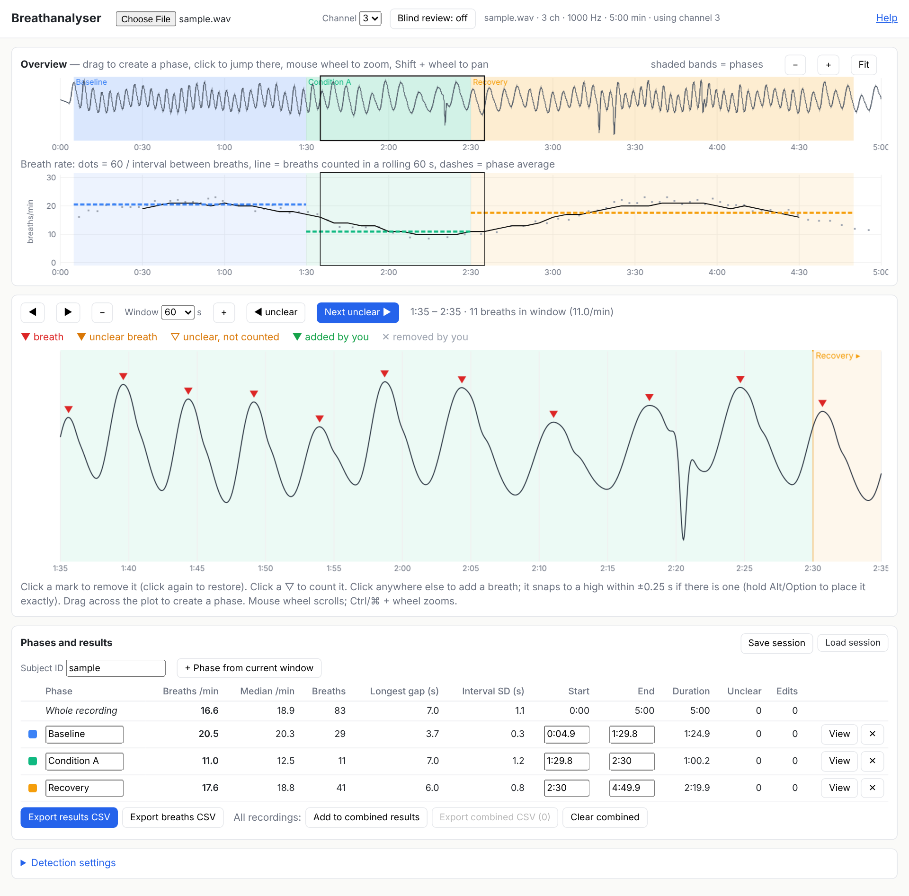

# Breathanalyser

Count breaths in respiratory plethysmography recordings, check every breath by eye, split the recording into phases and export breaths per minute for each phase.

**Open the app:** https://jonasprobst.github.io/rel-breathanalyser/

It runs entirely in your web browser. Recordings are **not uploaded** anywhere; nothing leaves your computer.

---

## Quick start (5 minutes)

1. **Open the app** and choose your `.wav` recording (or drag it onto the page).
2. **Check the channel.** Multi-channel files show a channel selector at the top. The app remembers the last channel you used.
3. **Validate the breaths** in the detail plot (middle):
   - Press **Next unclear ▶** (or the `N` key) to jump to the next doubtful breath.
   - **Click a mark** to remove a wrong breath (click again to restore it).
   - **Click a hollow ▽** to count a breath the detector was unsure about.
   - **Click anywhere else** to add a missed breath. It snaps to a peak within ±0.25 s; hold **Alt/Option** to place it exactly.
4. **Mark your phases** by dragging across the overview (top) or the detail plot. Rename them and fine-tune start/end times in the table at the bottom (type `m:ss` or seconds).
5. **Export:** *Export results CSV* (one row per phase) and, if needed, *Export breaths CSV* (one row per breath).
6. **Save session** to keep your edits and phases as a `.json` file. *Load session* restores them later or on another computer.

## The screen

| Area | What it shows | What you can do |
|---|---|---|
| **Overview** | The whole recording (filtered), phases as coloured bands, black box = what the detail plot shows | Drag = new phase · click = jump there · wheel = zoom · Shift + wheel = pan · −/+/Fit buttons |
| **Breath rate** | Grey dots = 60 / interval between two breaths; black line = breaths counted in a rolling 60 s; dashed = phase average | Click = jump there |
| **Detail plot** | The signal with every detected breath | Click to edit breaths, drag to create a phase · wheel = scroll · Ctrl/⌘ + wheel = zoom · ← → keys |
| **Phases and results** | One row per phase plus the whole recording | Rename, edit times, view, delete, export |

### Breath marks

| Mark | Meaning |
|---|---|
| ▼ red | Breath detected automatically |
| ▼ orange | Breath detected, but close to the size threshold (please check) |
| ▽ orange outline | Possible breath just below the threshold, **not counted** unless you click it |
| ▼ green | Breath you added |
| ✕ grey | Breath you removed (click to restore) |

## Results columns

| Column | Meaning |
|---|---|
| **Breaths /min** | Number of breaths in the phase ÷ phase duration in minutes |
| **Median /min** | 60 ÷ median interval between consecutive breaths. Robust against a single missed or extra breath. Needs at least 4 breaths |
| **Breaths** | Number of breaths in the phase (a breath belongs to the phase its peak falls in) |
| **Longest gap (s)** | Longest interval between two breaths, e.g. breath-holding or a pause |
| **Interval SD (s)** | Standard deviation of the intervals between breaths: breathing regularity |
| **Unclear** | Breaths near the size threshold in this phase, worth checking by eye |
| **Edits** | Breaths you added or removed in this phase |

Short phases give unstable rates: 30 s at 12 breaths/min is only 6 breaths, so one error changes the rate by 2/min. Always report the breath count together with the rate.

## Blind review

Turn on **Blind review** (top of the page) to hide all phases and results while validating breaths. The person checking breaths then can't be influenced by knowing which stretch belongs to which condition. Turn it off to see the results. Phases can't be created while blind review is on.

## Several recordings

1. Set the **Subject ID** (defaults to the file name).
2. When a recording is finished, click **Add to combined results**.
3. Repeat for each recording, then **Export combined CSV (n)** for one file with all subjects.

The combined list is kept in this browser only. Export it regularly, and keep each recording's own results CSV as the safe copy. If recordings were analysed with different detection settings, the app warns you on export.

## Exported files

**`<file>_results.csv`**: one row for the whole recording and one per phase:
`subject_id, file, channel, phase, start_s, end_s, duration_s, breaths, bpm_count, bpm_median_interval, longest_interval_s, interval_sd_s, unclear, manual_edits`, followed by the detection settings (`set_…`) and `tool_version`, so every result documents how it was produced.

**`<file>_breaths.csv`**: one row per breath: `subject_id, time_s, source (auto/manual), unclear (0/1), phase`.

**`<file>_session.json`**: phases, your manual edits, settings and channel. Load it again with *Load session*.

## Detection settings

Under *Detection settings* at the bottom. The defaults were tuned on a resting, standing horse (about 8–30 breaths/min). Your manual edits are kept when you change settings.

| Setting | Default | What it does |
|---|---|---|
| Min breath size | 35 % | A peak counts as a breath only if its rise is at least this share of the typical breath height around it (last/next 15 s) |
| Min time between breaths | 1.2 s | Two peaks closer than this are one breath (the higher one wins). Limits the maximum rate to about 50/min |
| Unclear band | ± 10 % | Peaks within this distance of the size threshold are marked orange / ▽ for review |
| High-pass | 0.05 Hz | Removes slow drift of the belt signal. Slowest countable rate ≈ 3/min |
| Low-pass | 1.0 Hz | Removes fast noise. Highest countable rate ≈ 60/min |
| Typical-size window | 30 s | Window used to judge what a "typical" breath looks like |
| Skip start | 0 s | Ignore the beginning of the recording, e.g. while the belt settles |

**For faster breathing** (foals, after exercise, other species): raise *Low-pass* (e.g. 2–3 Hz) and lower *Min time between breaths* (e.g. 0.4–0.6 s). Always check a few minutes by eye after changing settings, and use the same settings for all recordings of a study.

## Supported files

- `.wav` (RIFF/WAVE), PCM 8/16/24/32-bit or 32/64-bit float, any number of channels, any sampling rate.
- The selected channel is averaged down to 20 samples per second before analysis, which is plenty for breathing.
- Large files work (tested with 12 channels × 28 min at 4410 Hz, 177 MB).

## Use it offline

Download [`index.html`](index.html) from this repository and open it in your browser. Everything works the same without internet.

## Limitations

- Counts breaths from **one** belt signal. It doesn't measure tidal volume, chest/abdomen synchrony or inspiration/expiration timing.
- There is **no automatic movement detection**. Movement, sniffing, chewing and similar disturbances must be judged by eye.
- Detection is a support tool. The validated result is what you check and correct.
- Saved edits and the combined list live in your browser's storage. Use *Save session* and the CSV exports as your permanent record.

## Questions, bugs, ideas

Open an issue in this repository. Developer documentation is in [`docs/`](docs/).
