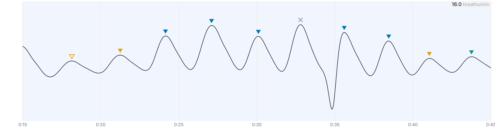

# Breathanalyser

Count, check and export breaths per minute from respiratory plethysmography recordings.

**Open the app:** https://jonasprobst.github.io/rel-breathanalyser/

Runs in your web browser. Recordings are **not uploaded**: nothing leaves your computer.


## Quick start

1. **Load** a `.wav` recording: drop it on the page or click *Choose file*.
2. **Check the channel** next to the file name. It must be the breathing belt.
3. **Check the breaths** in the *Detail* plot. Scroll through the recording and look closely at the **orange** marks.
   - Click a mark → remove a wrong breath (click again to restore).
   - Click a hollow ▽ → count it.
   - Click anywhere else → add a missed breath (snaps to the nearest peak; hold **Alt/Option** to place it exactly).
4. **Mark phases**: drag across the overview or the detail plot. Rename them and fine-tune times in the table (`m:ss` or seconds).
5. **Export** the results CSV (one row per phase) and, if needed, the breaths CSV (one row per breath).

Your work is saved automatically in this browser. To keep it elsewhere, use **Session → Save** (bottom of *Phases and results*).

## Breath marks

| Mark | Meaning |
|---|---|
| ▼ blue | Breath, detected automatically |
| ▼ orange | Breath, but close to the size threshold: **please check** |
| ▽ orange | Possible breath just below the threshold, **not counted** unless you click it |
| ▼ green | Breath you added |
| ✕ grey | Breath you removed |



## Results

| Column | Meaning |
|---|---|
| **Breaths /min** | Breaths in the phase ÷ phase duration in minutes |
| **Median /min** | 60 ÷ median interval between breaths. Robust against one missed or extra breath. Needs ≥ 4 breaths |
| **Breaths** | Number of breaths (a breath belongs to the phase its peak falls in) |
| **Longest gap (s)** | Longest interval between two breaths, e.g. breath-holding |
| **Interval SD (s)** | Standard deviation of the intervals: breathing regularity |
| **Unclear** | Orange marks in this phase, worth a look |
| **Edits** | Breaths you added or removed |

- If *Breaths /min* and *Median /min* differ a lot, the phase is irregular or contains errors: check it.
- Short phases give unstable rates: 30 s at 12/min is only 6 breaths. Report the count with the rate.
- The small number in the top-right corner of the detail plot is the rate of the visible window.

## Exported files

| File | Content |
|---|---|
| `<file>_results.csv` | One row for the whole recording and one per phase: the results columns above, plus subject ID, file, channel, the detection settings (`set_…`) and the app version |
| `<file>_breaths.csv` | One row per breath: time, `auto`/`manual`, unclear (0/1), phase |
| `<file>_session.json` | Your phases, edits, settings and channel. Open it again with *Session → Load* |

Several recordings: set the **Subject ID** for each and stack the results files. Every row carries subject, file, settings and version.

**In R** the CSVs open with plain `read.csv()`, also on Windows, no options needed:

```r
res <- read.csv("horse1_results.csv")
all <- do.call(rbind, lapply(list.files(pattern = "_results\\.csv$"), read.csv))  # all recordings
```

Missing values are `NA`. Accents in names are written without them (`ä` → `ae`) so every R version reads them correctly.

## Mouse and keys

| | Overview / rate graph | Detail plot |
|---|---|---|
| Click | Jump there | Add / remove a breath |
| Drag | New phase (overview) | New phase |
| Mouse wheel | Zoom | Scroll |
| Shift + wheel | Scroll | |
| Ctrl/⌘ + wheel | | Zoom |
| Buttons | 🔍 zoom, *Fit* | ◀ ▶ scroll, 🔍 zoom, *Window* length |
| Keys | | ← → scroll, `R` raw/filtered signal |

- Phase start and end snap to round times (1–30 s, depending on zoom). Hold **Alt/Option** for exact times.
- Click a phase in the table to show it in the detail plot. The bin icon deletes it.
- The detail plot's height stays steady while you scroll. It re-fits when you zoom or jump.

## Settings

Under *Settings* at the bottom of the page.

- **Raw signal**: show the original, unfiltered samples in the detail plot (key `R`), e.g. to tell a movement spike from a breath. Breaths are always detected on the filtered signal; switching never changes a result.
- **Blind review**: hides phases and results while you check breaths, so you can't be influenced by knowing which stretch is which condition.
- **Detection**: changes how breaths are found. Your manual edits are kept. Use the same settings for all recordings of a study.

| Detection setting | Default | What it does |
|---|---|---|
| Min breath size | 35 % | A peak counts only if its rise is at least this share of the typical breath height nearby |
| Min time between breaths | 1.2 s | Closer peaks count as one breath. Caps the rate at about 50/min |
| Unclear band | ± 10 % | Peaks this close to the threshold are marked orange / ▽ |
| High-pass | 0.05 Hz | Removes slow drift. Slowest rate ≈ 3/min |
| Low-pass | 1.0 Hz | Removes fast noise. Fastest rate ≈ 60/min |
| Typical-size window | 30 s | Stretch used to judge a "typical" breath |
| Skip start | 0 s | Ignore the beginning, e.g. while the belt settles |

Defaults were tuned on a resting, standing horse (about 8–30 breaths/min). **Faster breathing** (foals, exercise, small animals): raise *Low-pass* to 2–3 Hz and lower *Min time between breaths* to 0.4–0.6 s, then check a few minutes by eye.

**Start over** on a file: *Session → Clear*. This deletes all phases, edits, the subject ID and settings for that file and can't be undone.

## Offline use and versions

- **Offline:** click *download for offline use* at the bottom of the app. Copy the file (e.g. `breathanalyser-v1.2.0.html`) to the lab computer and double-click it.
- **Version:** shown at the bottom of the app and in every results row.
- **Earlier versions:** https://jonasprobst.github.io/rel-breathanalyser/v/ keeps every version online. If a new version changes your results, reopen the one you used before. Downloads and change notes: [Releases](https://github.com/jonasprobst/rel-breathanalyser/releases).

## Good to know

- Files: `.wav`, any number of channels and sampling rate (PCM 8–32 bit or float). Large files work (tested 177 MB).
- Counts breaths from **one** belt signal. No tidal volume or inspiration/expiration timing.
- **No movement detection**: judge movement, sniffing and chewing by eye.
- The detector is a support tool. The validated result is what you checked.
- Saved work lives in this browser only. Keep the CSV exports (and saved sessions) as your record.

## Questions, bugs, ideas

Open an [issue](https://github.com/jonasprobst/rel-breathanalyser/issues). Developer documentation: [`docs/`](docs/).

[MIT](LICENSE) © 2026 Jonas Probst
